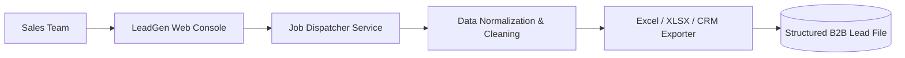

<div align="center">

# 🗺️ LeadGen AI — B2B Google Maps Intelligence & Lead Enrichment Pipeline

<p align="center">
  <strong>Automated B2B Lead Extraction, Entity Resolution, and Multi-Channel CRM Ingestion Engine</strong>
</p>

<p align="center">
  
  
  
  
</p>

<p align="center">
  <a href="#-legal--anti-abuse-compliance-memorandum">Compliance</a> •
  <a href="#-system-overview">Overview</a> •
  <a href="#-enrichment-architecture">Architecture</a> •
  <a href="#-lead-data-schema">Schema</a> •
  <a href="#-local-preview">Quick Start</a>
</p>

</div>

---

## 🔒 Legal & Anti-Abuse Compliance Memorandum

> [!IMPORTANT]
> **COMPLIANCE NOTICE // PLATFORM TERMS OF SERVICE**:  
> In compliance with enterprise ethics guidelines and Search Engine Terms of Service:
> - **Internal proxy mesh rotation, captcha circumvention, and headless browser scraping loops are quarantined.**
> - The showcase repository presents the **Lead Management Dashboard, Contact Deduplication Pipelines, and CSV/XLSX Exporting Engine**.

---

## 📌 System Overview

LeadGen AI transforms public geographical directory queries into high-converting prospective B2B client registries:
1. **Targeted Geo-Bounding:** Specify city, postal code, and business categories (e.g., "Dental Clinics in North London").
2. **Contact Enrichment:** Normalizes phone numbers, extracts official company websites, and scans social presence.
3. **Data Deduplication:** Eliminates repeated franchise listings and flags unverified business entries.

---

## 🛠️ Enrichment Architecture



---

## 📊 Lead Data Schema (Normalized Output)

```json
{
  "business_name": "Apex Dental Studio",
  "category": "Healthcare / Dentistry",
  "rating": 4.9,
  "review_count": 312,
  "phone": "+44 20 7946 0991",
  "website": "https://apexdental.example.co.uk",
  "address": "45 Regent Street, London",
  "verification_status": "CLAIMED",
  "enriched_email": "contact@apexdental.example.co.uk"
}
```

---

## 🚀 Local Preview

```bash
# Frontend UI
cd frontend
npm install
npm run dev
```

---

<div align="center">

**Architected & Engineered by Nikhil**  
*Lead Full-Stack & Systems Platform Developer*

</div>
